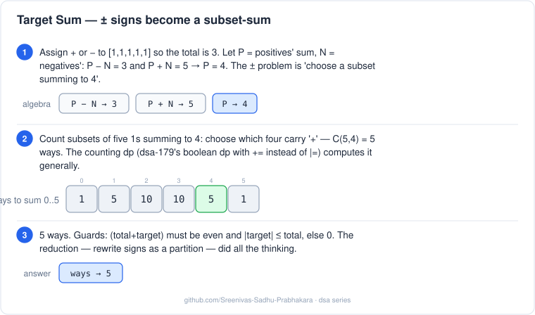

# Target Sum

> NeetCode 150 · 2-D DP — algebra first: P − N = target and P + N = total force P = (total+target)/2, turning sign assignment into subset counting. Go, stdlib only, tested.

## Problem

Put + or − before each number so the expression hits the target; count the assignments. `[1,1,1,1,1]` to 3 → 5 ways.

## Approach

Let P be the sum of the numbers given +, N the sum given −. Then P − N = target and P + N = total, so **P = (total + target) / 2** — fixed before any search. The problem is now "count subsets summing to P": dsa-179's boolean row upgraded to integer counts (`dp[s] += dp[s−v]`, backward sweep for single-use). The pre-checks carry real cases: |target| > total is impossible, and an odd total+target has no integer P (parity test pinned). Zeros are quietly interesting — each doubles the count since either sign works — falling out of the counting DP with no special handling (also pinned).

**Complexity:** O(n · (total+target)/2) time, O(goal) space.

## Visual walkthrough

Read the picture top to bottom — each numbered frame is one moment of the algorithm
running on this repo's test example.

## Run

    go test ./...   # verify
    go run .        # demo

---

Part of a 275-repo DSA series in Go — Striver's SDE Sheet (dsa-001–191) plus the NeetCode 150 / Blind 75 additions (dsa-192–275), stdlib only, every solution tested. Browse: [`dsa-*` repos](https://github.com/Sreenivas-Sadhu-Prabhakara?tab=repositories&q=dsa-&type=source).
